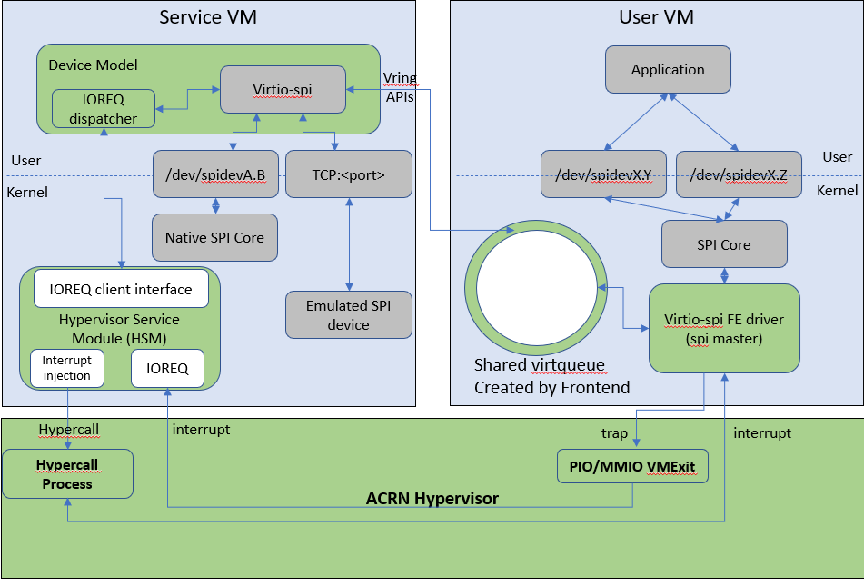

.. _virtio-spi:

Virtio-SPI
##########

Virtio SPI provides a virtual SPI master controller that supports multiple
chip selects. A physical device or emulated device can be assigned at each
chip select.

:numref:`virtio-spi-1` below shows the virtio-i2c architecture.

   Virtio-spi Architecture

Virtio-spi is implemented as a virtio modern device in the ACRN Device
Model (DM) and is registered as a PCI virtio device to the guest OS. The
Device ID of virtio-spi is ``0x106D`` and the Sub Device ID is
``0xFFF5``.

Virtio-spi uses one **virtqueue** to handle the spi transfers received
from guest. Each SPI transfer includes three or four parts:

- Header: includes various spi transfer parameters
- Tx/Rx buffer: includes the pointer to Tx/Rx buffer depends on the virtio
  descriptor flag
- Rx buffer: includes the pointer to Rx buffer, for full duplex transfers
- Result: includes the process results at the backend.

Virtio-spi also supports spi device backend emulators send events to front
end drivers via the event virtqueue. The event feature is optional.

The backend kick handlers wakes up a dedicated worker thread to handle spi
transfers and events. Spi transfer parameters and data buffers are
packed as a virtio spi transfer request and passed to corresponding spi
device backend.

Support spi device backends include:

- physical device
  Forward spi transfer to physical spi device like ``/dev/spidev0.0``.
  The physical spi device must have a device node like this which means the
  physical spi device should be bound to ``spidev`` driver.
- loopback
  A loopback device which always return received data. For test purpose only.

All spi devices are enumerated as a ``SPT0001`` device with ACPI node. Guest
linux thus will automatically bind them to the ``spidev`` driver.

**Usage:**

.. code-block:: none

   -s <slot>,virtio-spi,[physical:<bus>:<cs>][,physical:<bus>:<cs>][,loopback][,...]

``bus``:
   The bus number of the native SPI adapter, such as ``0``, ``1`` ...

``cs``:
   The chip select of the native SPI devices such as ``0``, ``1`` ...

**Example:**

.. code-block:: none

   -s 19,virtio-spi,physical:0:0,physical:1:1,loopback

This adds a virtio spi controller and three spi devices attached. The first
two are physical spi devices and the third one is a loopback device.

Note that the virtual SPI bus number has no relationship with the native
SPI bus number; it is auto-generated by the guest OS. The virtual chip select
is the index of the device in command line.
